  

## Welcome

  

  

Hi, thank you for visiting my repository. You can find here a lot of code snippets, examples and projects I published on my blog - https://blog.podkalicki.com

  

  

  

## Credits

If you like my code sharing, then please star this repository. You can also become a [sponsor](https://github.com/sponsors/lpodkalicki) of my opensource work. 
Thank you! :)

## Any Question? Need Help?

Please send me an mail at lpodkalicki@gmail.com.

  

