# Project
3-channel Disco Lights using FFT (esp-open-rtos;FreeRTOS)
https://www.youtube.com/watch?v=pYBcp9oU5tE

# Compilation
https://blog.podkalicki.com/esp8266-building-the-toolchain-for-linux-ubuntu/

